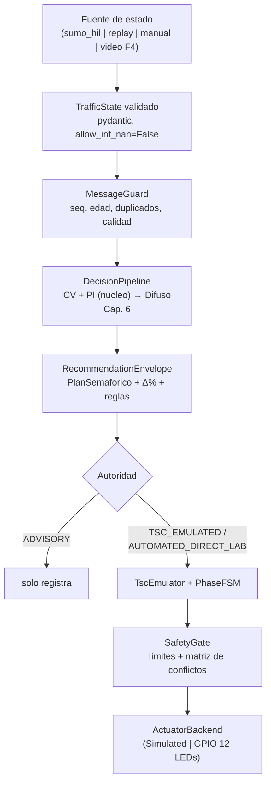

# Arquitectura NSB v2.1

Nodo Semafórico de Borde: una intersección, un proceso monohilo, núcleo
científico canónico **reutilizado, no duplicado**.

## Flujo de decisión

El Safety Kernel (límites de la tesis + FSM + matriz de conflictos + gate)
envuelve TODA salida hacia actuación; ninguna recomendación lo puentea.

## Paquetes (`Diseño Software/nsb/`)

| Paquete | Responsabilidad |
|---|---|
| `domain/` | Contratos pydantic (TrafficState, Recommendation, Decision), enums, wire |
| `core/` | Adaptadores al núcleo canónico (`nucleo/`) + DecisionPipeline + predictor (D-01: interfaz, sin CNN-LSTM) |
| `safety/` | límites, matriz de conflictos N/S/E/O (D-05), SafetyGate, MessageGuard |
| `tsc/` | PhaseFSM (transiciones seguras), TscEmulator, relojes inyectables (D-B) |
| `authority/` | resolución de modo + triple compuerta direct-lab (D-H) |
| `actuation/` | SimulatedActuator (Windows) / GPIOActuator (Pi, import perezoso) |
| `sources/` | manual, replay, video (F4, solo ADVISORY) |
| `vision/` | proveedor dual-ROI sobre el pipeline YOLO existente + ground truth (F4) |
| `hil/` | protocolo TCP JSON-lines, gateway SUMO, cliente del nodo (D-03) |
| `telemetry/` | eventos correlacionables, JSONL (siempre), HTTP opcional |
| `comms/` | sink MQTT TLS opcional (plano de telemetría — D-02, D-F) |
| `faults/` | inyección de fallos declarativa (spec §32) |
| `cli/` | `python -m nsb` (run/record/digest/gateway/bench/demo) |

## Los tres planos (D-02)

- **Data plane HIL**: TCP JSON-lines síncrono dedicado — `hil_protocol.md`.
- **Telemetría**: JSONL local (fuente de verdad) → HTTP backend existente →
  MQTT opcional — `mqtt_tls.md`.
- **Command plane**: API FastAPI existente (JWT+RBAC); NSB no crea una
  segunda autenticación.

## Decisiones estructurales clave

- **Monohilo, sockets síncronos stdlib** (D-03): traci es bloqueante y el
  protocolo es estrictamente secuencial; asyncio solo añadiría
  no-determinismo. Los únicos hilos extra: red de paho (telemetría, jamás
  decide) y render opcional de LEDs (lee snapshot).
- **El reloj vive en el gateway** (D-B): SUMO es la única fuente de
  `sim_time`; la FSM usa `Clock` inyectable (Sim/Wall/Manual).
- **Sin pyproject** (D-04): bootstrap de imports; el despliegue a Pi copia
  carpetas conservando el layout (`/home/pi/nsb-node/`, ruta ASCII).
- **El modo solo se degrada en runtime** (D-H): se fija al construir el
  proceso; ninguna vía remota lo eleva.
- **PI = variante de `comparacion_sumo._demanda_fase`** (D-D): la que produjo
  los resultados multibaseline versionados; universo [0,1] del difuso.

Registro completo de decisiones y desviaciones: `decisions.md`.
